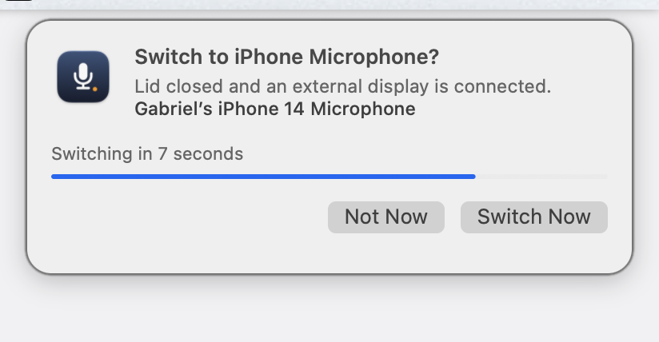

# MicLid

A small macOS menu bar utility that switches your audio input to the **iPhone
Continuity microphone** when your MacBook is in clamshell mode on an external
display without AirPods connected.



With the lid shut, the built-in microphone is muffled and picks up the desk.
The iPhone's microphone sounds noticeably better, but macOS never offers it at
the moment you need it. MicLid watches the setup and asks once, with an
eight-second countdown that switches automatically.

## Install

Download the latest release, unzip it, and drag **MicLid.app** into
`/Applications`.

The app is ad-hoc signed, not notarised, so the first launch needs one of:

- right-click **MicLid** → **Open** → **Open**, or
- `xattr -dr com.apple.quarantine /Applications/MicLid.app`

It then lives in the menu bar with no Dock icon. Use **Launch at Login** in its
menu if you want it to start automatically.

Requires macOS 13 or later. The release build is Apple silicon (arm64).

### Build from source

```bash
git clone https://github.com/gabathanasiou/miclid.git
cd miclid
swift test
./scripts/install.sh
```

`install.sh` builds `MicLid.app`, installs it to `/Applications` (or
`~/Applications` if that is not writable), and launches it. Requires Xcode 15
or newer for the Swift 5.9 toolchain.

## Use

| Gesture | Action |
|---|---|
| Left click | Switch between the iPhone mic and AirPods; without AirPods it toggles iPhone ↔ built-in |
| Right click, Control-click | Full menu |
| Keyboard (Control-F8, then Space) | Full menu |

The icon shows the current input: iPhone, AirPods, headphones, or the built-in
microphone. An orange dot means a switch is being suggested.

The menu has **Switch Input** for any device, **When Connected** to choose the
behaviour, **Launch at Login**, **Show Prompt**, and a link to Sound settings.

## Behaviour

- **Ask to Switch** (default) — a floating card with an eight-second countdown.
  It switches on its own when the countdown ends unless you choose Not Now.
- **Switch Automatically** — switches once per clamshell session, no prompt.
- **Do Nothing** — detection only.

**Not Now** suppresses the suggestion until the setup changes. If the setup
changes while the countdown runs, the card disappears and nothing is switched.

When the environment ends (lid opens, monitor disconnects, AirPods connect) the
input you had before is restored. If you had selected the iPhone mic by hand,
MicLid falls back to the built-in mic instead of leaving the phone selected —
unless you picked another device in the meantime.

## Requirements

- macOS 13 or later, with an external display and a MacBook that reports
  `AppleClamshellState`
- An iPhone on the same Apple ID, nearby and locked, with Continuity Camera
  enabled (System Settings → General → AirPlay & Continuity)
- No AirPods or other Bluetooth input device connected, by design

## Limitations

- The iPhone microphone only exists in CoreAudio while Continuity publishes it.
  If the phone is in use, asleep, or out of range, MicLid cannot offer it.
- Apps that are already capturing audio do not always follow a default-input
  change mid-call. Switching before joining a call is always reliable.
- The iPhone microphone is wireless: expect slightly more latency and battery
  use than the built-in mic.
- The prompt is an in-app card rather than a system notification, so it looks
  and behaves the same on every Mac without notification permissions.

### When not to use it

If you only change microphones occasionally, the Sound section in Control
Center is enough. MicLid is not a general audio switcher — it exists for the
specific "lid closed, external display, no AirPods" moment.

## How it works

Three signals, one action:

- `IOPMrootDomain.AppleClamshellState` (IOKit) for the lid
- `CGGetOnlineDisplayList` (CoreGraphics) for external displays
- CoreAudio device enumeration for the iPhone mic (transport `ccwl` / `ccwd`),
  AirPods, and Bluetooth input devices

Switching is a single `AudioObjectSetPropertyData` call for the default input
device. MicLid never records audio, requests no microphone permission, makes no
network requests, and stores only the chosen behaviour mode in `UserDefaults`.

## Development

```bash
swift build                 # debug build
swift test                  # 13 logic tests
./scripts/build-app.sh      # build build/MicLid.app
./scripts/install.sh        # build, install, launch
swift scripts/make-icon.swift  # regenerate Resources/AppIcon.icns
```

The package has no external dependencies. Detection and toggle rules live in
`Sources/MicLid/Logic/Decider.swift` and are unit tested without touching the
system.

Considering Mac App Store distribution? See
[docs/APP_STORE.md](docs/APP_STORE.md) for the sandbox findings and the
required changes.

## License

MIT — see [LICENSE](LICENSE).
